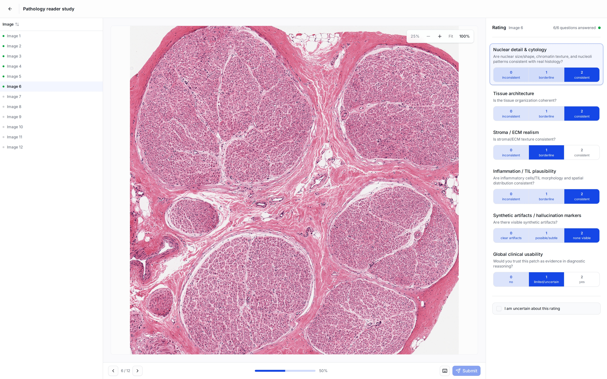
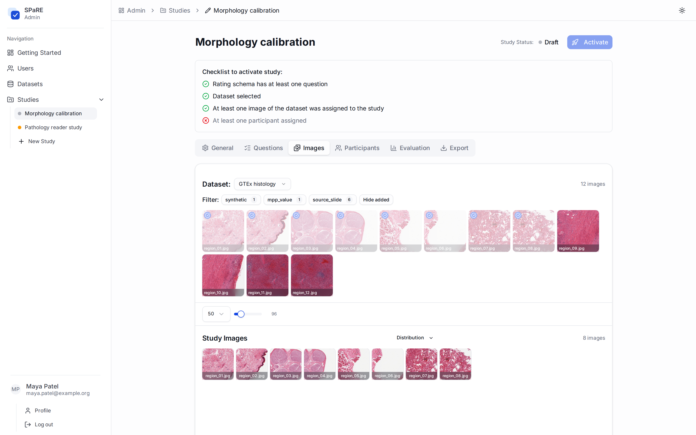
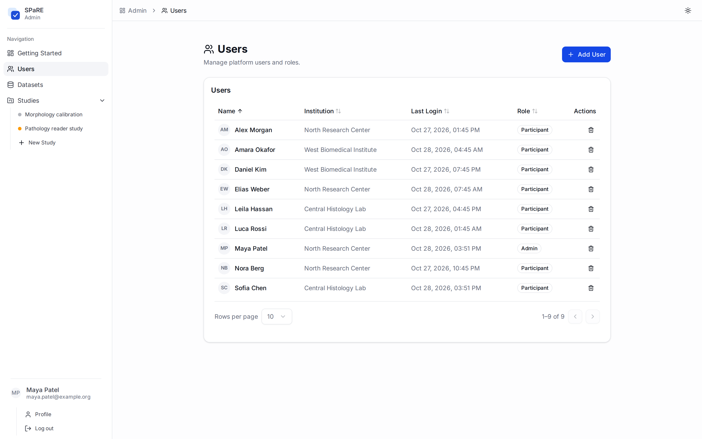
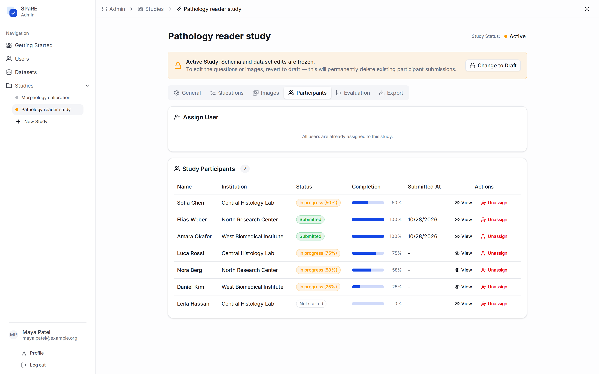
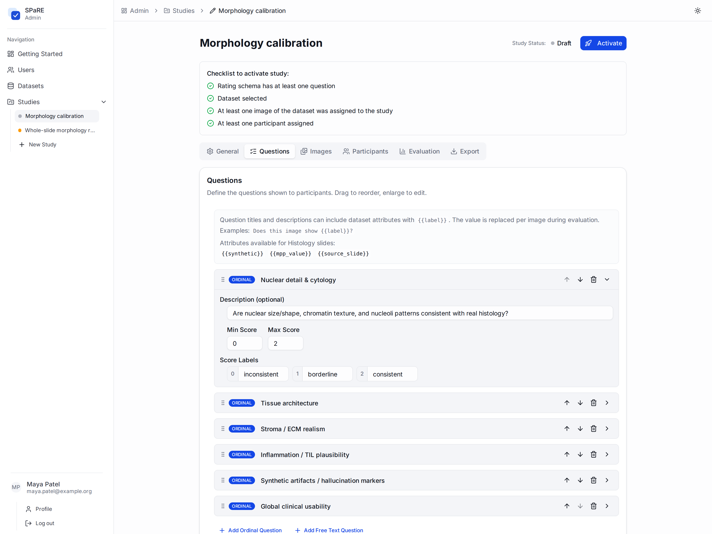
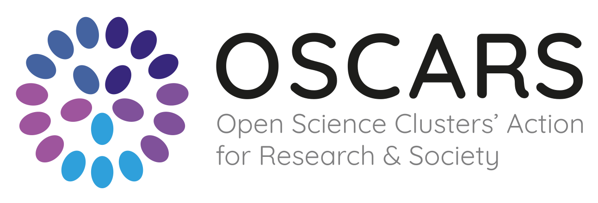

<h1 align="center">
  <picture>
    <source media="(prefers-color-scheme: dark)" srcset="docs/assets/spare-logo-dark.svg">
    
  </picture>
</h1>

<p align="center"><strong>Synthetic Pathology Reader Evaluation</strong></p>

<p align="center">Web-based reader studies for whole-slide pathology · Integrated xOpat WSI viewer</p>

<p align="center">
  <a href="#quick-start">Quick start</a> ·
  <a href="#features">Features</a> ·
  <a href="#screenshots">Screenshots</a> ·
  <a href="#documentation">Documentation</a> ·
  <a href="#local-development">Local development</a>
</p>

SPaRE is a **self-hosted, web-based application** developed for **whole-slide image (WSI) analysis and reader evaluation** of synthetic and real pathology. Its integrated **[xOpat](https://github.com/RationAI/xopat) web-based WSI viewer** lets readers navigate large slides, zoom from tissue overview to fine detail, and record ratings alongside the image. Image patches and smaller regions are also supported.

**Participants need only a web browser.** They open the study link and sign in, with **no local WSI viewer to install and no large dataset to download**. Whole-slide files stay on the server; xOpat loads image tiles as readers pan and zoom.

Study organizers create studies, curate slides, and invite readers. Ratings save as participants work, and administrators can follow progress and export the results.

[](screenshots/participant-evaluate.jpg)

<p align="center"><sub>Participant workspace with selected ratings. Click any screenshot to view it at full resolution.</sub></p>

## Features

- **Evaluate whole-slide images.** Inspect large pathology slides in the bundled xOpat web-based WSI viewer, with tiled deep zoom and pan from slide overview to tissue detail.
- **Design your evaluation.** Configure ordinal scales, text questions, conditional failure reasons, and uncertainty flags.
- **Curate your dataset.** Import image folders with CSV metadata, filter by attributes, and select images for each study.
- **Include image patches.** Use the native image viewer for smaller images and extracted regions, with the same rating workflow.
- **Coordinate your readers.** Manage accounts, assign participants, and track completion and final submissions.
- **Explore the results.** Review agreement statistics and group comparisons, export CSV data, or continue in optional Jupyter notebooks.
- **Host it yourself.** Run on your own infrastructure with Docker Compose and persistent local storage.

## Quick start

The following setup is for the **study host**; participants access the deployed application through their browser.

To host SPaRE, install Docker Engine or Docker Desktop with **Compose v2**, plus Git, Bash, and OpenSSL. Use Linux, macOS, or WSL2 on Windows.

```bash
git clone https://github.com/human-centered-ai-lab/spare-pathology.git
cd spare-pathology
./scripts/configure.sh
docker compose up -d --build --wait
```

Open **[localhost:8000](http://localhost:8000)** and sign in with `admin` and the generated password printed by `configure.sh`.

The first build downloads dependencies and builds the image viewers. Configuration and credentials are saved in `.env`; keep that file private. Running `configure.sh` again preserves existing settings. A fresh installation creates the administrator account without demo users or studies.

<details>
<summary>Check the services and view logs</summary>

```bash
docker compose ps
curl --fail http://localhost:8000/healthz
docker compose logs -f
```

</details>

The application listens on localhost by default. For remote participants, follow the [deployment guide](docs/deployment.md) to configure public HTTPS hosting. It also covers backups, upgrades, configuration, and optional notebooks.

## Your first study

1. **Import a dataset.** Open **Datasets** and upload a folder containing your slides or images and `metadata.csv`. Large datasets can also be imported on the server; see the [dataset guide](docs/datasets.md).
2. **Set up the study.** Create a study, select its images, and configure rating questions, instructions, and an optional protocol PDF. Select **XOpat** as the viewer for whole-slide images.
3. **Invite readers.** Create participant accounts and assign them to the study. Test accounts can preview all studies and are excluded from analysis.
4. **Start collecting ratings.** Activate the study after its readiness checks pass, then share the deployment URL and each reader's credentials privately.
5. **Review and export.** Follow participant progress, explore the results, and download the ratings as CSV.

<details>
<summary>Example dataset structure</summary>

```text
my_dataset/
├── metadata.csv
├── slide_001.svs
└── slide_002.svs
```

```csv
image_name,synthetic,mpp_value
slide_001.svs,false,0.5
slide_002.svs,true,0.5
```

`image_name` is required and may include relative subdirectories. Other columns become filterable attributes: `true`/`false` are booleans, and finite numbers are numeric values. Use neutral filenames when study blinding matters; filenames are accessible through image URLs and the API.

</details>

See the [dataset guide](docs/datasets.md) for supported image formats, metadata rules, and server-side imports.

## Screenshots

<table>
  <tr>
    <td width="50%" valign="top">
      <strong>Curate image datasets</strong>
      <p>Browse tissue thumbnails and choose the images for each study.</p>
      <a href="screenshots/admin-project-dataset.png"></a>
    </td>
    <td width="50%" valign="top">
      <strong>Manage your team</strong>
      <p>Create accounts and review roles, institutions, and recent activity.</p>
      <a href="screenshots/admin-users.png"></a>
    </td>
  </tr>
  <tr>
    <td width="50%" valign="top">
      <strong>Follow participant progress</strong>
      <p>See completion percentages and submitted evaluations at a glance.</p>
      <a href="screenshots/admin-project-participants.png"></a>
    </td>
    <td width="50%" valign="top">
      <strong>Design your rating form</strong>
      <p>Define pathology questions, scoring scales, and descriptive score labels.</p>
      <a href="screenshots/admin-project-schema.png"></a>
    </td>
  </tr>
</table>

Screenshots use illustrative accounts, institutions, and ratings.

## Documentation

| Guide | What you'll find |
| --- | --- |
| [Deployment and operations](docs/deployment.md) | HTTPS hosting, configuration, persistent storage, backups, upgrades, and notebooks |
| [Dataset format](docs/datasets.md) | Supported images, CSV metadata, upload validation, and study blinding |
| [Release validation](docs/release-validation.md) | Completed checks, test coverage, and validation limits |
| [Changelog](CHANGELOG.md) | Release notes and changes |

## Local development

For local development, install **Python 3.11 or 3.12**, **Node.js 24 LTS**, npm, Git, Bash, and OpenSSL, then run:

```bash
./start.sh
```

The script prepares the development environment and starts Flask and Vite. Open **[localhost:5173](http://localhost:5173)**; stop with Ctrl+C. Use the Docker setup above for deployment.

## Acknowledgements

SPaRE was developed within [PRIVAGAMS](https://oscars-project.eu/projects/privagams-services-privacy-advancement-through-generative-ai-and-model-sanitisation), supported through the [OSCARS](https://oscars-project.eu/) Open Call. OSCARS receives funding from the European Union's Horizon Europe research and innovation programme under grant agreement [No. 101129751](https://cordis.europa.eu/project/id/101129751).

<p>
  <a href="https://oscars-project.eu/"></a>&nbsp;&nbsp;
  <a href="https://cordis.europa.eu/project/id/101129751"><picture>
    <source media="(prefers-color-scheme: dark)" srcset="docs/assets/eu-funded-dark.png">
    
  </picture></a>
</p>

## License

Copyright © 2026 SPaRE contributors. SPaRE is licensed under the [GNU General Public License v3.0](LICENSE) (`GPL-3.0-only`). Bundled third-party components retain their own licenses; see [third-party notices](THIRD_PARTY_NOTICES.md).
